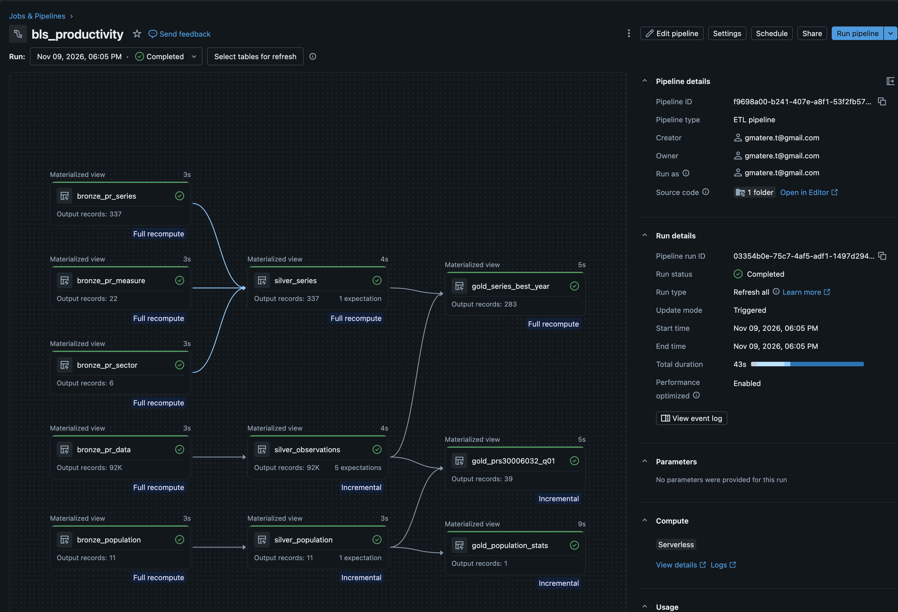
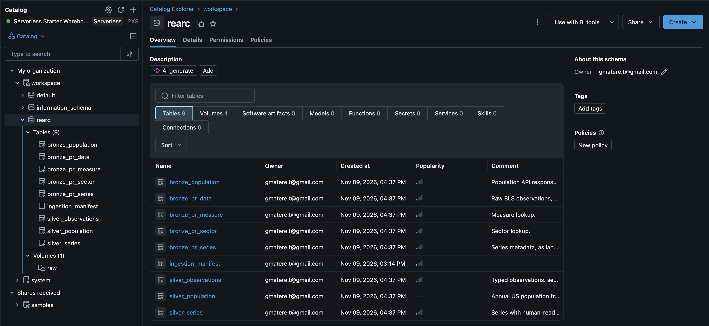
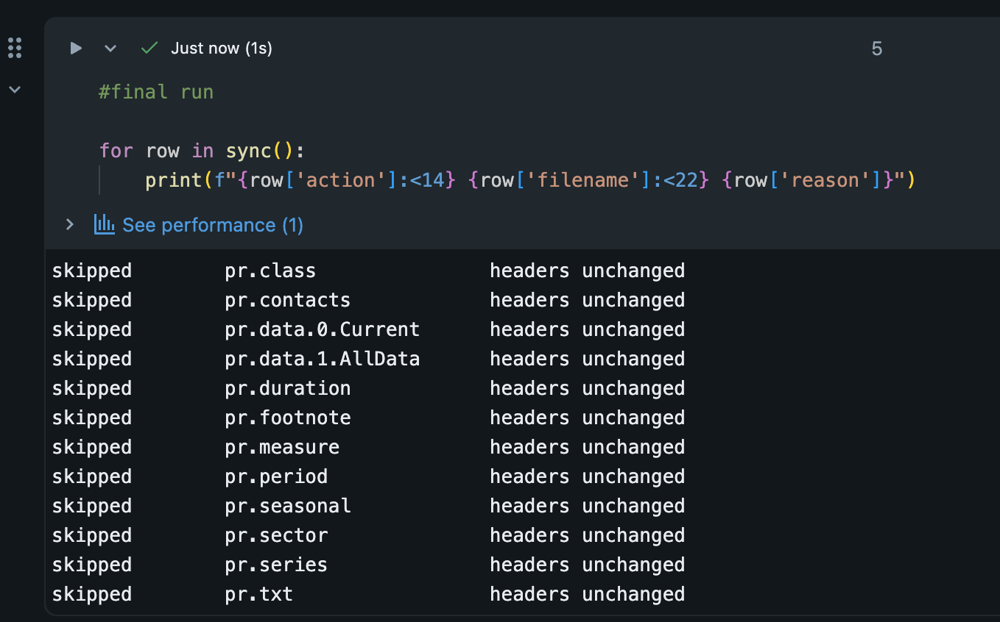

# BLS Productivity Pipeline

US labour productivity time series (Bureau of Labor Statistics) and national
population (Data USA), ingested and modelled on Databricks with Delta Lake,
Unity Catalog and a Spark Declarative Pipeline.

**[PROCESS.md](PROCESS.md)** has the architecture, the trade-offs and the
retrospective — including the two ambiguities in the questions and the
cold-start bug that nearly shipped.

---

## The answers

### 1. Mean and standard deviation of annual US population, 2013–2018

| | |
|---|---:|
| Mean | **322,069,808** |
| Standard deviation (sample) | **4,158,441.04** |
| Standard deviation (population) | **3,796,119.94** |
| Years observed | 6 |

Both forms are given. The question doesn't say which, and 2013–2018 is the
complete set of years it names rather than a sample from a wider population —
so the population form is arguably the better default, while Spark's `stddev`
returns the sample form. See `PROCESS.md`.

### 2. Best year per series

**283 series** have a best year, each labelled with what it measures.

| series_id | series_label | year | summed_value |
|---|---|---:|---:|
| PRS30006011 | Employment for the Manufacturing sector, % Change same quarter 1 year ago | 2022 | 16.40 |
| PRS30006012 | Employment for the Manufacturing sector, % Change from previous quarter | 2022 | 13.00 |
| PRS30006013 | Employment for the Manufacturing sector, Index (2017=100) | 1989 | 578.37 |
| PRS30006014 | Employment for the Manufacturing sector, Level (Millions of jobs) | 1989 | 73.69 |
| PRS30006021 | Average weekly hours for the Manufacturing sector, % Change same quarter 1 year ago | 2010 | 14.20 |

_First five of 283, ordered by `series_id`._

The label is `series_title` from `pr.series` — BLS's own wording. The four
`PRS300060 1x` series above measure the same thing in four different ways, and
a label built from sector and measure alone would have rendered all four
identically.

`Q05` is **excluded**: `pr.period` defines it as the annual average, not a
fifth quarter, so summing `Q01`–`Q05` would add the mean of four values to
those same four values. Ties go to the earliest year.

337 series exist in `pr.series`; the 54 without a best year carry no non-`Q05`
observations in the data file.

### 3. `PRS30006032`, `Q01`, by year with population

**39 rows**, 1988–2026. Population is present for 11 of them — the API covers
2013–2019 and 2021–2024 (ACS published no 1-year estimate for 2020). The
question asks for population *where available*, so this is a left join and the
unmatched years are kept.

---

## How it runs

### 1. Source

`notebooks/01_ingest.py` — run interactively.

Scrapes the [BLS `pr/` directory](https://download.bls.gov/pub/time.series/pr/)
at runtime, so no filenames are hardcoded, and lands all 12 files plus the
population API response into a Unity Catalog Volume.

Re-running is safe: a manifest table records each file's ETag, Last-Modified
and SHA-256, and only genuinely changed content is re-downloaded. Files removed
upstream are tombstoned, not deleted. A second run reports 13 × `skipped`.

### 2. Model

`notebooks/bronze_silver.py` and `notebooks/gold.py` — the source of the
Spark Declarative Pipeline `bls_productivity`, target `workspace.rearc`.

```
bronze_pr_data ─────────► silver_observations ──┬──► gold_series_best_year
bronze_pr_series ──┐                            │
bronze_pr_sector ──┼────► silver_series ────────┘
bronze_pr_measure ─┘                            ├──► gold_prs30006032_q01
bronze_population ──────► silver_population ────┴──► gold_population_stats
```

Expectations on Silver enforce the expected schema and non-null keys.

### 3. Alternatives

`notebooks/03_alternatives.sql` — the same three questions in Spark SQL.

PySpark is primary and builds the Gold tables. The SQL file also contains an
equivalence check that full-outer-joins the SQL result for question 2 against
the PySpark Gold table and counts disagreements. **It returns 0.**

---

## Screenshots








---

## Layout

| Path | |
|---|---|
| `notebooks/01_ingest.py` | sourcing and the ingestion manifest |
| `notebooks/bronze_silver.py` | Bronze and Silver, with expectations |
| `notebooks/gold.py` | the three answers, PySpark |
| `notebooks/03_alternatives.sql` | the three answers in SQL, plus the equivalence check |
| `PROCESS.md` | architecture, trade-offs, retrospective |
| `screenshots/` | pipeline and table evidence |
